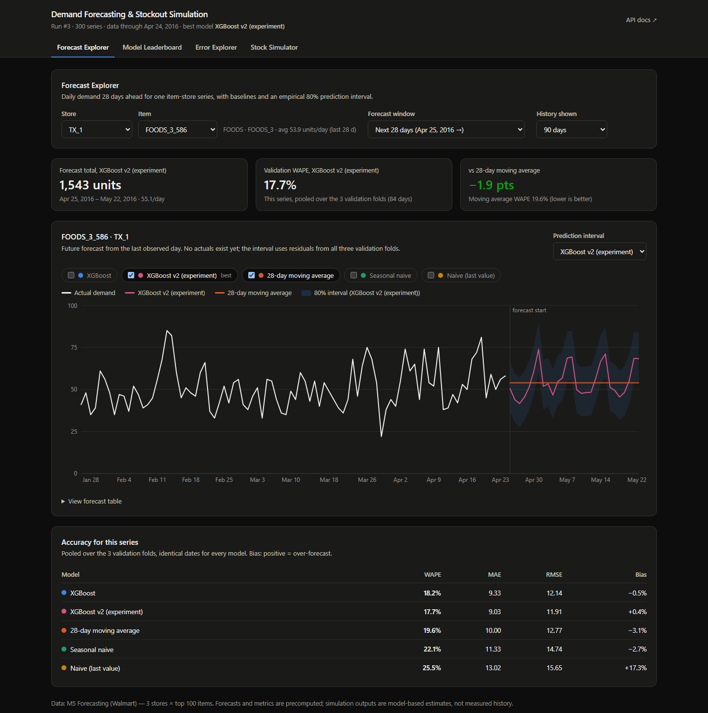
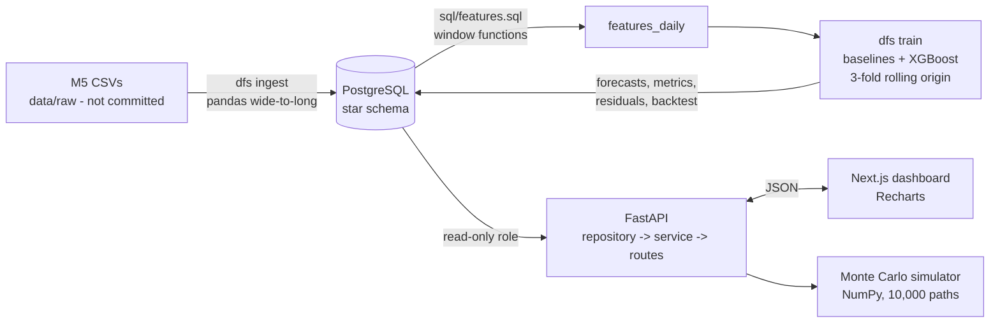
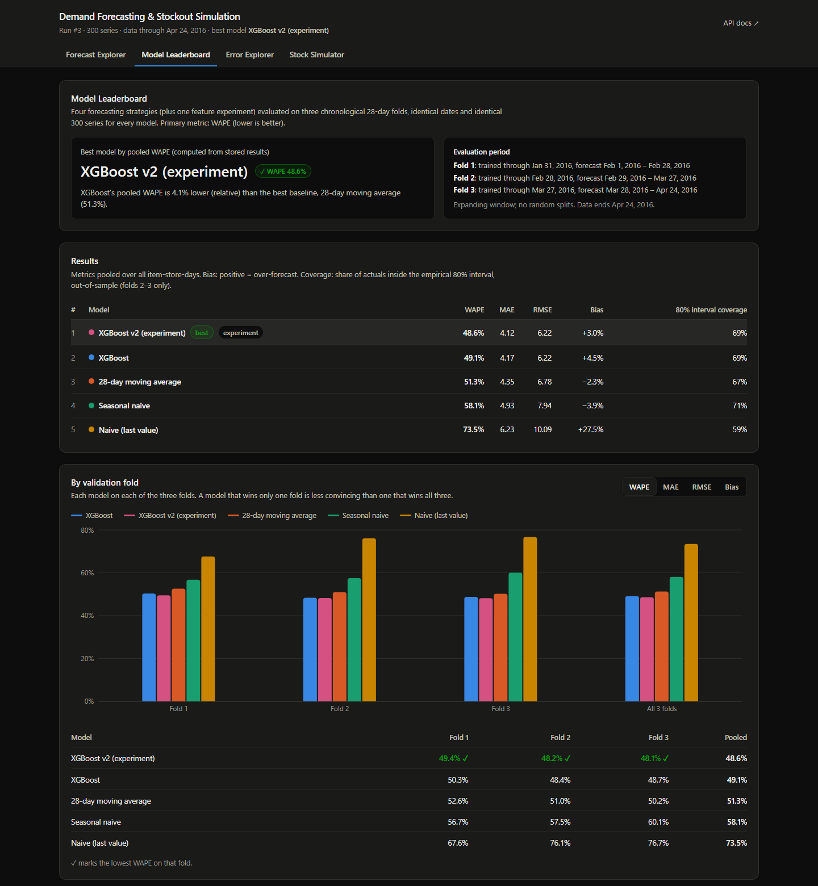
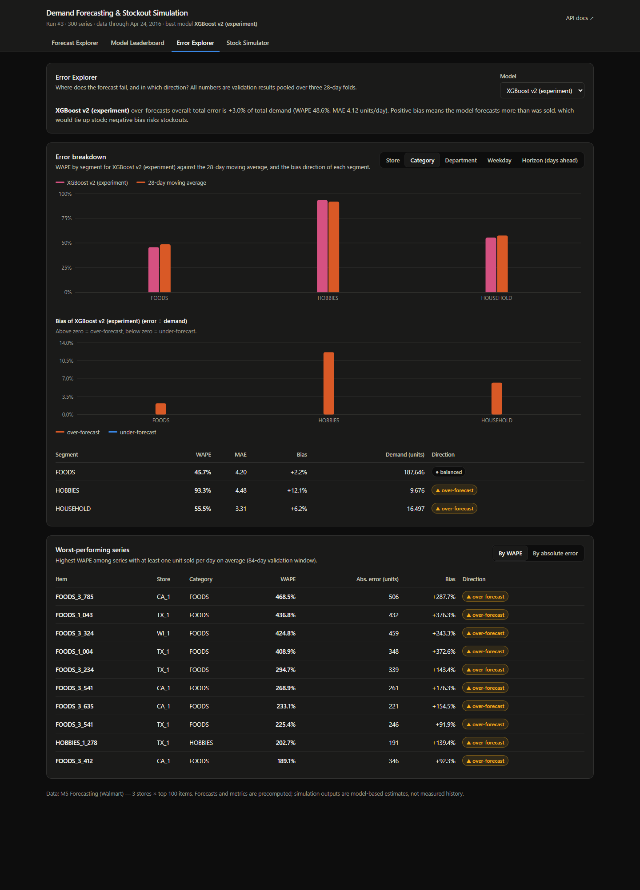
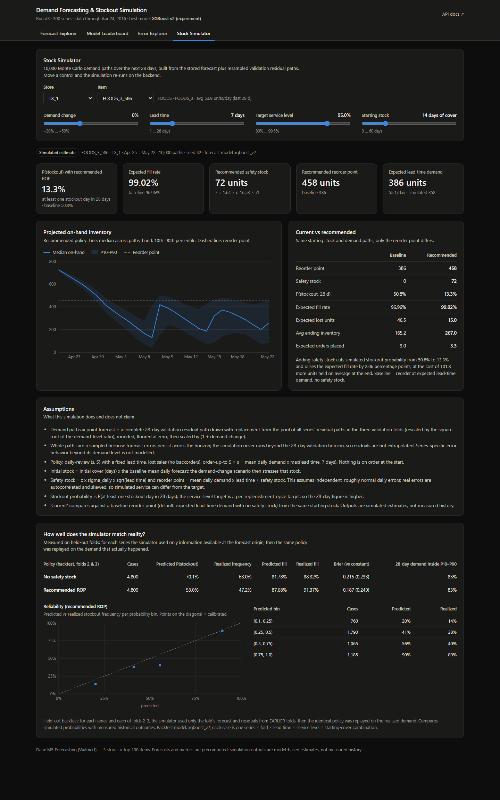

# Demand Forecasting & Stockout Simulation

An end-to-end retail analytics project on the public **M5 (Walmart)** dataset: it forecasts daily demand 28 days ahead
for 300 item-store series, compares XGBoost against three simple baselines on three chronological validation folds,
quantifies forecast error and uncertainty, and runs a 10,000-path Monte Carlo inventory simulation that recommends
safety stock and reorder points. Everything is served by a FastAPI backend (reading precomputed results from PostgreSQL)
and explored through a Next.js dashboard.

> All numbers in this document were produced by the code in this repository (run id 3, seed 42) and are stored in
> PostgreSQL. Nothing is hand-entered. Simulation outputs are model-based estimates; measured historical outcomes are
> labelled as such.



## Contents
1. [Problem and use cases](#problem-and-use-cases) · 2. [Architecture](#architecture) · 3. [Tech stack](#tech-stack) ·
4. [Dataset](#dataset) · 5. [Database schema](#database-schema) · 6. [Feature engineering](#feature-engineering) ·
7. [Validation methodology](#validation-methodology) · 8. [Results](#results) · 9. [Error analysis and experiment](#error-analysis-and-experiment) ·
10. [Simulator](#simulator-methodology-and-assumptions) · 11. [Setup](#setup-and-execution) · 12. [API](#api) ·
13. [Dashboard](#dashboard) · 14. [Testing](#testing-and-ci) · 15. [Deployment](#deployment) · 16. [Limitations](#limitations-and-future-work) · 17. [Resume bullets](#resume-bullets-verified-numbers-only)

## Problem and use cases
Replenishment planners need to know (a) how much of each item will sell, (b) how wrong that estimate typically is, and
(c) how much stock to hold given supplier lead times. This project answers those three questions for a 28-day horizon:
a point forecast with an empirical 80% interval, an honest comparison with trivial baselines, and a stockout-risk simulator
that turns forecast uncertainty into safety stock and reorder-point recommendations.

## Architecture

Training and ingestion run offline as separate CLI commands; the API never retrains, it serves persisted results (and runs
the simulator on demand from stored forecasts and residuals).

```
dfs/            python package: ingest, quality, features, models, evaluation, simulation, pipeline, api/
sql/            schema.sql (idempotent), features.sql (SQL transformations), quality.sql (data-quality checks)
tests/          pytest suite (unit + PostgreSQL integration in an isolated schema)
frontend/       Next.js (App Router) + TypeScript + Tailwind + Recharts
docker-compose.yml  local PostgreSQL        Makefile / dev.ps1  developer commands        .github/workflows/ci.yml
```

## Tech stack
Python 3.11, pandas, NumPy, scikit-learn (installed; not used for modelling), XGBoost 3, PostgreSQL 16 + SQL,
psycopg 3, FastAPI + Pydantic v2, Next.js 16 (App Router) + TypeScript + Tailwind CSS 4 + Recharts, pytest, ruff,
Docker Compose, GitHub Actions. No Redis, no queues, no microservices.

## Dataset
**M5 Forecasting - Accuracy** (Walmart, via the Kaggle competition). Kaggle requires a login and acceptance of the competition
rules, so `dfs download` fetches the three CSVs (`calendar.csv`, `sales_train_validation.csv`, `sell_prices.csv`) from the
Hugging Face mirror `kashif/M5`; their byte sizes match the official files. If you prefer the official source, download them from
<https://www.kaggle.com/competitions/m5-forecasting-accuracy/data> into `data/raw/`.
**Licensing:** the data is provided for the M5 competition under Kaggle's competition terms; this repository does not
redistribute it (`data/` is git-ignored). Check the competition rules before reusing it commercially.

**Subset used.** Stores `CA_1`, `TX_1`, `WI_1`; the 100 items with the highest total unit sales **up to d_1829** (the day
before the first validation fold, so item selection cannot see validation data) -> **300 item-store series**,
`2011-01-29 .. 2016-04-24` (1,913 days). After dropping pre-launch days (see below) the fact table holds **538,515 daily
item-store rows**.

**Missing prices and new items.** In M5 a missing weekly price means "not on sale", not price 0. Days before an item-store's
first priced week are dropped (they are not demand; 35,385 rows removed), and any later missing price stays `NULL` with a
`price_missing` flag. (In this subset no priced series has a later gap, so `price_missing` is always 0; the code path is
covered by tests.) Series need at least 91 days of history before the first fold's origin to be evaluated; all 300 qualified.

## Database schema
Star schema in PostgreSQL (`sql/schema.sql`, idempotent):

| Table | Purpose |
|---|---|
| `dim_item`, `dim_store`, `dim_date` | dimensions (dim_date includes the 56 days past the last sale for known-in-advance covariates) |
| `fact_sales` | one row per item-store-date, PK `(item_id, store_id, date)` |
| `fact_price` | weekly price, PK `(item_id, store_id, wm_yr_wk)` |
| `features_daily` | SQL-built features per row (below) |
| `model_runs` | run metadata: seed, folds (as JSON), best model (computed), config |
| `forecasts` | per run/model/fold/series/day: prediction, 80% bounds, actual (`fold 0` = future forecast) |
| `metrics` | WAPE/MAE/RMSE/bias/coverage per model x fold x segment (overall, store, category, dept, weekday, horizon, series) |
| `validation_residuals` | residual paths reused by the simulator |
| `simulator_backtest` | predicted vs realized stockout/fill outcomes on held-out folds |

Data-quality checks (`sql/quality.sql`, `dfs quality`; 13 checks, all pass on the loaded data): duplicate keys, negative
sales, missing dates inside series, series not ending on the expected date, invalid prices, unexpected series count,
orphaned item-store pairs, features row-count and warm-up nulls, zero price stored as a price. The same classes of problem
are validated in pandas before loading (`dfs.quality`) and tested with injected violations.

## Feature engineering
Rows for day *t* use only sales on days **<= t-1** (`sql/features.sql`):
`lag_7/14/28`, `roll_mean_7/28` (window frames end at `1 PRECEDING`), day of week, month, day of month, weekend flag,
event flag/type, SNAP flag for the store's state, `sell_price`, `price_change_1w`, `price_missing`, item/store/department/category ids.
Calendar, SNAP and price columns for day *t* are **known-in-advance covariates** (the M5 price table contains planned prices for
future weeks); this is an assumption you would need to confirm in a real deployment.

**Leakage prevention.** The only function that computes sales-derived features (`dfs.features.sales_features`) receives
just the history up to the forecast origin, so later columns cannot be read. Tests (`tests/test_features_leakage.py`) assert:
features at *t* are identical when every sale on/after *t* is replaced with garbage; a recursive forecast is bit-identical when
actuals inside the horizon are replaced; each training fit sees only rows with `t <= origin`; and (on PostgreSQL) the SQL
`features_daily` equals the Python features row for row.

**Multi-day forecasting strategy: recursive.** To forecast day origin+h the model uses actuals up to the origin and its *own
earlier predictions* for the days in between (lags 7/14/28 and rolling means are re-computed on that mixed history). No
actual from inside the horizon is ever used. One global XGBoost model is trained across all 300 series
(`reg:squarederror`, 300 trees, depth 6, learning rate 0.05, subsample 0.8, column subsample 0.8, seed 42; no hyperparameter search).

## Validation methodology
Three **rolling-origin, chronological, non-overlapping 28-day folds** (expanding training window, no random splits):

| Fold | Trained through | Forecast window |
|---|---|---|
| 1 | 2016-01-31 | 2016-02-01 .. 2016-02-28 |
| 2 | 2016-02-28 | 2016-02-29 .. 2016-03-27 |
| 3 | 2016-03-27 | 2016-03-28 .. 2016-04-24 |

Every model is evaluated on identical dates and the same 300 series. The model is refit at each origin. After the folds, a
final fit on all data produces the **future forecast for 2016-04-25 .. 2016-05-22** (no actuals exist for it).
Strategies: **naive** (last value), **seasonal naive** (same weekday last week), **28-day moving average**, **global XGBoost**.
Metrics: **WAPE** (primary; `sum|e| / sum(actual)`, reported as *undefined/null* when a segment's total demand is zero),
MAE, RMSE, and bias (mean of prediction - actual; positive = over-forecast; also as % of demand).
**80% prediction intervals** are per-series empirical 10th/90th percentiles of that series' residuals from *strictly earlier*
folds, floored at zero. Fold 1 therefore has no interval, fold 2 uses fold 1, fold 3 uses folds 1-2, the future forecast uses all three.

## Results
Pooled over all item-store-days (300 series x 84 days = 25,200 per model), WAPE lower is better:

| Model | Fold 1 | Fold 2 | Fold 3 | **Pooled WAPE** | MAE | RMSE | Bias | 80% interval coverage* |
|---|---|---|---|---|---|---|---|---|
| **XGBoost v2 (experiment)** | **49.4%** | **48.2%** | **48.1%** | **48.6%** | 4.12 | 6.22 | +3.0% | 69% |
| XGBoost | 50.3% | 48.4% | 48.7% | 49.1% | 4.17 | 6.22 | +4.5% | 69% |
| 28-day moving average | 52.6% | 51.0% | 50.2% | 51.3% | 4.35 | 6.78 | -2.3% | 67% |
| Seasonal naive | 56.7% | 57.5% | 60.1% | 58.1% | 4.93 | 7.94 | -3.9% | 71% |
| Naive | 67.6% | 76.1% | 76.7% | 73.5% | 6.23 | 10.09 | +27.5% | 59% |

\* out-of-sample, folds 2-3 only; the nominal level is 80%, so the **intervals are too narrow** (they under-cover by about 11 points).

What actually happens: XGBoost beats every baseline on every fold, but the margin over the 28-day moving average is modest:
**WAPE 49.1% vs 51.3% (4.1% relative reduction)**; with the experimental feature set 48.6% (5.2%). No significance test was run;
fold-to-fold differences of ~1 point are within what I would expect from noise. The naive and seasonal-naive baselines are much worse
because daily retail demand is noisy and a single past day is a poor level estimate.
The leaderboard's "best model" is computed from the stored metrics (currently the v2 experiment).

## Error analysis and experiment
Pooled XGBoost (v1) WAPE by slice:

| Slice | XGBoost v1 | 28-day MA | XGBoost bias |
|---|---|---|---|
| FOODS / HOUSEHOLD / **HOBBIES** | 46.2% / 56.3% / **94.1%** | 48.6% / 57.6% / **91.9%** | +3.9% / +7.5% / **+12.3%** |
| Dept **FOODS_1** | **76.9%** | 72.0% | **+27.0%** |
| Horizon 1-7 / 8-14 / 15-21 / 22-28 days | 47.3 / 50.7 / 48.5 / 50.1% | 51.3 / 51.2 / 49.5 / 53.0% | +8.1 / +8.3 / +3.3 / -1.4% |

Findings: (1) error barely grows with horizon (noise, not recursion drift, dominates); (2) XGBoost over-forecasts, most in the
low-volume intermittent categories (HOBBIES, FOODS_1) where it loses to the moving average; (3) the worst individual series are
all over-forecasts of 200-470% WAPE caused by **demand collapses**: items that sell normally and then record zero sales for ~two
months (e.g. `FOODS_1_004` / TX_1: 301 units in Jan, 85 in Feb, 0 in Mar-Apr). 17 of 300 series had recent demand below half of their
prior level; they carry 5.6% of the absolute error but under 1% of demand, so they do not drive the pooled WAPE. Zero sales during
a stockout are censored demand rather than zero demand, which a sales-only model cannot see.

**Controlled experiment (`xgboost_v2`).** Motivated by (2), the feature set was extended *once*, before looking at its results, with
`roll_mean_91`, `roll_std_28`, `same_dow_mean_4w`, `roll_max_28` (longer-run level, volatility, same-weekday history), using the same folds,
seed and hyperparameters. Result: pooled WAPE **49.1% -> 48.6%**, better on all three folds, bias +4.5% -> +3.0%. The gain is small
(about 1% relative), and the HOBBIES (93.3%) and FOODS_1 (74.7%) gaps to the moving average remain. I did not iterate on v2.

## Simulator methodology and assumptions
`dfs/simulation.py` (vectorized NumPy, **10,000 paths**, seeded and deterministic). For a chosen item-store:

1. **Demand paths** = stored 28-day point forecast + a complete residual path drawn with replacement from a *pool* of validation
   residual paths (all series, all three folds; each rescaled by `sqrt(level_target / level_source)`), rounded and floored at 0, then multiplied by
   `1 + demand change` (-30% .. +50%).
2. **Inventory policy (the only one implemented):** daily-review `(s, S)` with lost sales and fixed lead time (1-28 days). Start of day:
   arrivals join stock; demand is served from on-hand, the rest is lost; end of day, if *inventory position* (on-hand + on-order) <= `s`, order up to
   `S = s + mean daily demand x max(L, 7)`; the order arrives `L` days later. Initial stock = days of cover x mean forecast, nothing on order.
3. **Analytical reference:** `safety stock = z x sigma_daily x sqrt(L)`, `reorder point = mean daily demand x L + safety stock`
   (`z` from the target service level, 80%-99.5%; `sigma_daily` = s.d. of the level-scaled pooled daily residuals).
   Assumes i.i.d., roughly normal daily errors, constant lead time, and a cycle service level; real errors are autocorrelated and skewed.
4. **Outputs:** P(at least one stockout in 28 days), expected fill rate (units served / units demanded, ratio of expectations), recommended
   safety stock and reorder point, expected lead-time demand, and a comparison of the recommended reorder point with a no-safety-stock baseline
   on identical demand paths and starting stock. The service-level target is per replenishment cycle, so the 28-day stockout probability is higher.

**How uncertainty is sampled / extended.** The simulation horizon equals the validation horizon (28 days), so residuals are used step-for-step and never
extrapolated to longer horizons. The first version resampled 7-day blocks of each series' own residuals; a probability-integral-transform check on the
held-out folds showed **59-71% of realized 28-day demand totals fell outside the simulated 10-90% band (20% expected)**, because errors persist as a level
shift across the horizon. I therefore switched to resampling whole 28-day paths pooled across series. This diagnosis used the same held-out folds as the
backtest below, so those calibration numbers are mildly optimistic (two alternatives were compared; the `sqrt` scaling was fixed in advance).

**Backtest (measured, held-out folds 2-3).** For each series the simulator used only the fold's forecast and residual paths from earlier folds; the identical
policy was then replayed on the demand that actually occurred. 4,800 cases per policy (series x fold x lead time {7,14} x service level {90,95%} x starting cover {7,14} days):

| Policy | Predicted P(stockout) | **Realized** | Predicted fill | **Realized** | Brier (constant-guess Brier) | Realized 28-day demand inside simulated P10-P90 |
|---|---|---|---|---|---|---|
| Recommended reorder point | 53.0% | **47.2%** | 87.7% | **91.4%** | 0.187 (0.249) | 83% |
| No safety stock | 70.1% | **63.0%** | 81.8% | **88.3%** | 0.215 (0.233) | 83% |

Reading: the demand distribution is well calibrated (83% vs 80% nominal) and stockout probabilities beat a constant guess (Brier 0.187 vs 0.249), but the simulator
is **conservative**: it over-predicts stockout probability by about 6-7 points and under-predicts fill rate by about 3-7 points. The reliability table is in the dashboard.

## Setup and execution
Prerequisites: Python 3.11+, Node 20+, Docker (for PostgreSQL). The Makefile (Unix) and `dev.ps1` (PowerShell) expose the same targets.

**Windows PowerShell**
```powershell
Copy-Item .env.example .env            # edit the passwords (placeholders only in the example)
./dev.ps1 setup                        # venv + dependencies
./dev.ps1 db-up                        # PostgreSQL in Docker (host port 5433 by default)
./dev.ps1 db-init                      # apply schema, create read-only API role
./dev.ps1 download                     # M5 CSVs -> data/raw (~320 MB)
./dev.ps1 ingest                       # build star schema + features_daily (about 2 min)
./dev.ps1 quality                      # 13 SQL data-quality checks
./dev.ps1 train                        # 4 strategies x 3 folds (+ experiment) + backtest, ~6-10 min
./dev.ps1 serve                        # API on http://localhost:8000  (docs at /docs)
cd frontend; npm ci; npm run dev       # dashboard on http://localhost:3000
```
**Unix-like shells**
```bash
cp .env.example .env && make setup && make all-data   # db-up, db-init, download, ingest, quality, train
make serve                                            # API
make frontend-install && make frontend-dev            # dashboard
```
Each stage is a separate command (`dfs db-init | download | ingest | features | quality | train | serve`). Re-running `dfs ingest` rebuilds the star schema from the CSVs;
`dfs train` adds a new run (the API serves the latest). If port 5432 is taken by another PostgreSQL, change `POSTGRES_PORT` and the URLs in `.env`.
Nothing requires a paid API. Raw data and credentials are never committed (`.gitignore`).

## API
Interactive docs at `/docs`. Every error is `{"detail": "..."}`. The API connects with the **read-only** `dfs_readonly` role (verified: writes fail with
`InsufficientPrivilege`), uses parameterized SQL, and takes all configuration from environment variables (`DATABASE_URL_READONLY`, `ALLOWED_ORIGINS`).

| Endpoint | Description |
|---|---|
| `GET /health` | API + database status and latest run id |
| `GET /series?store=&category=&search=&limit=&offset=` | paginated series list (limit <= 500) with 28-day average sales and validation WAPE |
| `GET /forecast?item=&store=&model=&fold=&history_days=` | history + forecasts (repeat `model` for several; default all) with 80% bounds; `fold` 0 = future, 1-3 = validation (with actuals) |
| `GET /metrics?segment_type=&model=&fold=` | metrics for `overall/store/category/dept/weekday/horizon/series`, plus run info (`fold 0` = pooled folds) |
| `GET /errors/top?n=10&model=&sort_by=wape\|abs_error&min_volume=` | worst series with over/under-forecast direction (`n` 1-100) |
| `POST /simulate` | body: `item, store, model?, demand_change_pct (-30..50), lead_time_days (1..28), service_level (0.8..0.995), initial_cover_days, current_reorder_point?, n_paths (1000..20000), seed` |
| `GET /simulation/backtest` | measured calibration of the simulator on held-out folds |

Status codes: 200, 400 (unknown model/fold), 404 (unknown series), 422 (validation), 503 (no run stored / database down).

## Dashboard
Four views, all backed by the real API (no sample data): **Forecast Explorer** (series/window selectors, actual vs forecast, baselines, 80% interval, accuracy table),
**Model Leaderboard** (pooled and per-fold WAPE/MAE/RMSE/bias, best model computed from results, evaluation period), **Error Explorer** (worst series, breakdowns by store/category/department/weekday/horizon,
bias direction), **Stock Simulator** (four live controls, stockout probability, fill rate, safety stock, reorder point, current-vs-recommended, assumptions, backtest calibration). Loading, error and empty states are implemented; dark mode follows the OS.

| Leaderboard | Error Explorer | Stock Simulator |
|---|---|---|
|  |  |  |

## Testing and CI
`pytest` (109 tests): metrics incl. zero-demand WAPE; feature values and leakage; chronological fold boundaries; baseline/XGBoost shapes and determinism; interval properties;
simulator mechanics checked by hand (lead times, inventory position, lost sales), determinism and probability ranges; API contract/validation with a fake repository; and PostgreSQL integration tests in an
isolated schema with synthetic data (idempotent schema, quality checks passing and failing, SQL-vs-Python feature equality, end-to-end persistence and API read-back). They skip automatically without PostgreSQL.
`.github/workflows/ci.yml` runs ruff, pytest (with a Postgres service) and the frontend lint and production build.

## Deployment
Not deployed (no hosting credentials were available). To deploy: (1) provision a managed PostgreSQL, run `dfs db-init`, `dfs ingest`, `dfs train` against it from your machine
(the dataset stays local); (2) deploy the API from the included `Dockerfile` to any container host (Render, Fly.io, Railway, Cloud Run) with `DATABASE_URL_READONLY` and
`ALLOWED_ORIGINS=https://<your-frontend>`; (3) import the repo into Vercel with root directory `frontend` and `NEXT_PUBLIC_API_URL=https://<your-api>`.

## Limitations and future work
- Sales are censored demand: zero-sales days during stockouts are treated as demand, which biases forecasts and the simulator downward for affected series (see error analysis).
- Interval coverage is 69% against an 80% target; a conformal or horizon/level-aware scheme would likely fix this.
- XGBoost's edge over the moving average is modest and untested for significance; low-volume intermittent items (HOBBIES, FOODS_1) are better served by the moving average or a count/Tweedie model.
- Prices for future weeks are assumed known; promotions beyond price/SNAP/events are not modelled.
- The simulator implements one policy, assumes fixed lead time and lost sales, and is conservative on the backtest. Only 300 series and ~3.5 months of validation are used.
- Future work: Tweedie/quantile objectives, hierarchical reconciliation, stockout-aware demand estimation, multi-echelon policies, scheduled retraining.

## Resume bullets (verified numbers only)
- Built an end-to-end demand forecasting and stockout-simulation platform on the M5 retail dataset (PostgreSQL star schema, 538,515 daily item-store rows, 300 series, 28-day horizon) with SQL feature pipelines, 13 automated data-quality checks and leakage tests.
- Evaluated naive, seasonal-naive, 28-day moving-average and global XGBoost (recursive multi-step) forecasts on three chronological rolling-origin folds: XGBoost reached 49.1% WAPE vs 51.3% for the best baseline (4.1% relative reduction; 5.2% with an error-analysis-driven feature set), winning every fold, while reporting that its 80% intervals under-covered (69%).
- Implemented a vectorized 10,000-path Monte Carlo inventory simulator with an (s, S) lost-sales policy and safety-stock/reorder-point recommendations; backtested on held-out folds: realized 28-day demand fell inside the simulated 10-90% band 83% of the time and stockout probabilities beat a constant guess (Brier 0.187 vs 0.249), while being conservative on stockout risk (53% predicted vs 47% realized).
- Shipped a FastAPI service (service/repository layers, read-only DB role, Pydantic validation) and a Next.js/Recharts dashboard with four views, 109 automated tests and a GitHub Actions CI pipeline.
